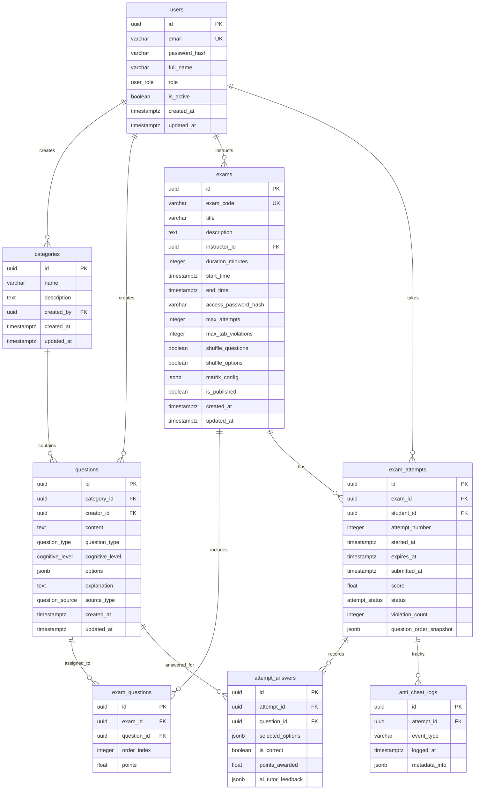

# 🗄️ HƯỚNG DẪN KIẾN TRÚC & SỬ DỤNG CƠ SỞ DỮ LIỆU (DATABASE GUIDE)
## DỰ ÁN: SMART QUIZ — NỀN TẢNG KIỂM TRA VÀ ÔN LUYỆN TRẮC NGHIỆM TRỰC TUYẾN AI

> **Tài liệu bàn giao nội bộ:** Dành cho 4 thành viên nhóm phát triển (Dev 1 -> Dev 4) tra cứu cấu trúc bảng, quy tắc nghiệp vụ, cấu trúc JSONB và cách truy vấn qua SQLAlchemy 2.0.

---

## 1. Tổng quan Kiến trúc CSDL

- **File SQL DDL thuần (Pure SQL Script):** Đã đóng gói sẵn tại [`database/schema.sql`](file:///e:/Data_IT_MSI/Project_Nam4/QuanTriDuAnPhanMem/smart-quiz/database/schema.sql) và dữ liệu mẫu tại [`database/seed.sql`](file:///e:/Data_IT_MSI/Project_Nam4/QuanTriDuAnPhanMem/smart-quiz/database/seed.sql) để import trực tiếp lên Server DB (pgAdmin, DBeaver, Supabase, Neon, v.v.). Xem hướng dẫn chi tiết tại [database/README.md](file:///e:/Data_IT_MSI/Project_Nam4/QuanTriDuAnPhanMem/smart-quiz/database/README.md).
- **Hệ quản trị CSDL:** PostgreSQL 13+ (Khuyến nghị 16, hỗ trợ 100% Supabase, Neon hoặc Local Postgres).
- **Trình ánh xạ ORM & Migration:** SQLAlchemy 2.0 kiểu khai báo mới (`DeclarativeBase`, `Mapped[...]`, `mapped_column(...)`) và Alembic.
- **Khóa chính toàn hệ thống:** `UUID` v4 tự động sinh bằng hàm `gen_random_uuid()` của PostgreSQL, tầng ứng dụng có fallback `default=uuid.uuid4`.
- **Đơn vị thời gian:** Mọi cột thời gian đều dùng `timestamptz` (`DateTime(timezone=True)`) và lưu theo chuẩn UTC. Cột `updated_at` tự động cập nhật qua `onupdate=func.now()` ở tầng ORM.
- **Thang điểm:** `Float` (`double precision` trong PostgreSQL), chuẩn hóa thang điểm 10, tầng ứng dụng làm tròn 2 chữ số thập phân trước khi lưu.
- **Quy chuẩn đặt tên ràng buộc (Naming Convention):**
  - Khóa chính: `pk_%(table_name)s`
  - Khóa ngoại: `fk_%(table_name)s_%(column_0_name)s_%(referred_table_name)s`
  - Duy nhất: `uq_%(table_name)s_%(constraint_name)s`
  - Kiểm tra: `ck_%(table_name)s_%(constraint_name)s`
  - Chỉ mục: `ix_%(column_0_label)s`

---

## 2. Sơ đồ Quan hệ Thực thể (ERD Diagram)



---

## 3. Danh mục 5 Kiểu Enum PostgreSQL

Các kiểu Enum này được tạo ở mức Database Engine (PostgreSQL Native Types):

| Tên Kiểu Enum | Các giá trị hợp lệ | Mục đích sử dụng |
| :--- | :--- | :--- |
| **`user_role`** | `'ADMIN'`, `'INSTRUCTOR'`, `'STUDENT'` | Phân quyền vai trò người dùng hệ thống (RBAC). |
| **`question_type`** | `'SINGLE_CHOICE'`, `'MULTIPLE_CHOICE'`, `'TRUE_FALSE'` | Phân loại định dạng câu hỏi trắc nghiệm (1 đáp án, nhiều đáp án, đúng/sai). |
| **`cognitive_level`** | `'REMEMBER'`, `'UNDERSTAND'`, `'APPLY'` | Thang đo nhận thức Bloom: Nhận biết, Thông hiểu, Vận dụng. |
| **`attempt_status`** | `'IN_PROGRESS'`, `'SUBMITTED'`, `'LOCKED_VIOLATION'`, `'EXPIRED'` | Vòng đời bài làm của sinh viên: Đang làm, Đã nộp, Khóa do gian lận, Hết giờ. |
| **`question_source`** | `'MANUAL'`, `'FILE_PARSER'`, `'AI_GENERATED'` | Nguồn gốc câu hỏi: Nhập thủ công, Bóc tách từ file tài liệu, hoặc AI sinh. |

---

## 4. Đặc tả Chi tiết 8 Bảng Thực thể & Ràng buộc Nghiệp vụ

### 4.1. Bảng `users` (Tài khoản người dùng)
* **Khóa chính:** `id` (UUID, default `gen_random_uuid()`).
* **Cột:**
  * `email` (`varchar(255)`): Email đăng nhập duy nhất. **Ràng buộc:** Bắt buộc viết thường toàn bộ qua `CHECK (email = lower(email))`.
  * `password_hash` (`varchar(255)`): Mật khẩu đã được băm Bcrypt.
  * `full_name` (`varchar(255)`): Họ và tên hiển thị.
  * `role` (`user_role`): Vai trò (mặc định `'STUDENT'`).
  * `is_active` (`boolean`): Trạng thái hoạt động (mặc định `true`).
  * `created_at`, `updated_at` (`timestamptz`): Thời điểm tạo và cập nhật.
* **Ràng buộc duy nhất:** `uq_users_email` trên `(email)`.

---

### 4.2. Bảng `categories` (Chuyên đề / Học phần)
* **Khóa chính:** `id` (UUID).
* **Cột:**
  * `name` (`varchar(255)`): Tên học phần / chuyên đề.
  * `description` (`text`, nullable): Mô tả chi tiết.
  * `created_by` (`uuid`): Khóa ngoại tham chiếu `users(id)` với hành vi **`ON DELETE RESTRICT`** (không cho phép xóa tài khoản khi đang sở hữu chuyên đề).
  * `created_at`, `updated_at` (`timestamptz`).
* **Ràng buộc duy nhất:** `uq_categories_created_by_name` trên `(created_by, name)` (Một giảng viên không được tạo 2 chuyên đề trùng tên).

---

### 4.3. Bảng `questions` (Ngân hàng câu hỏi)
* **Khóa chính:** `id` (UUID).
* **Cột:**
  * `category_id` (`uuid`): FK -> `categories(id)` (`ON DELETE RESTRICT`).
  * `creator_id` (`uuid`): FK -> `users(id)` (`ON DELETE RESTRICT`).
  * `content` (`text`): Nội dung câu hỏi (chấp nhận text/markdown/HTML).
  * `question_type` (`question_type`): Dạng câu hỏi.
  * `cognitive_level` (`cognitive_level`): Mức nhận thức Bloom.
  * `options` (`jsonb`): Danh sách lựa chọn đáp án.
  * `explanation` (`text`, nullable): Lời giải thích gốc cho câu hỏi.
  * `source_type` (`question_source`): Nguồn tạo (mặc định `'MANUAL'`).
  * `created_at`, `updated_at` (`timestamptz`).
* **Ràng buộc kiểm tra:** `ck_questions_options_is_array` bắt buộc `options` phải là mảng JSON có **từ 2 đến 10 phần tử**.
* **Chỉ mục:**
  * `ix_questions_creator_category` trên `(creator_id, category_id)`.
  * `ix_questions_matrix` trên `(category_id, cognitive_level, question_type)` hỗ trợ thuật toán lọc ma trận siêu tốc.

---

### 4.4. Bảng `exams` (Kỳ thi / Đề thi)
* **Khóa chính:** `id` (UUID).
* **Cột:**
  * `exam_code` (`varchar(12)`): Mã đề thi công khai (duy nhất, ví dụ `'DEMO0001'`).
  * `title` (`varchar(255)`): Tiêu đề kỳ thi.
  * `description` (`text`, nullable): Hướng dẫn làm bài.
  * `instructor_id` (`uuid`): FK -> `users(id)` (`ON DELETE RESTRICT`).
  * `duration_minutes` (`integer`): Thời lượng làm bài (phút). **CHECK:** `duration_minutes > 0`.
  * `start_time`, `end_time` (`timestamptz`, nullable): Khung thời gian mở và đóng đề thi. **CHECK:** `end_time > start_time`.
  * `access_password_hash` (`varchar(255)`, nullable): Mật khẩu truy cập phòng thi (nếu có).
  * `max_attempts` (`integer`): Giới hạn lượt làm bài (mặc định 1). **CHECK:** `>= 1`.
  * `max_tab_violations` (`integer`): Ngưỡng vi phạm chuyển tab tối đa trước khi tự khóa (mặc định 3). **CHECK:** `>= 1`.
  * `shuffle_questions` (`boolean`): Bật/tắt trộn thứ tự câu hỏi (mặc định `true`).
  * `shuffle_options` (`boolean`): Bật/tắt trộn phương án trả lời (mặc định `true`).
  * `matrix_config` (`jsonb`, nullable): Cấu hình ma trận đề thi (nếu sinh tự động).
  * `is_published` (`boolean`): Trạng thái công bố đề (mặc định `false`). **CHECK:** Nếu `is_published = true` thì bắt buộc `start_time` và `end_time` **không được NULL**.
  * `created_at`, `updated_at` (`timestamptz`).

---

### 4.5. Bảng `exam_questions` (Liên kết Đề thi - Câu hỏi)
* **Khóa chính:** `id` (UUID).
* **Cột:**
  * `exam_id` (`uuid`): FK -> `exams(id)` với **`ON DELETE CASCADE`** (xóa đề thi sẽ tự xóa liên kết câu hỏi).
  * `question_id` (`uuid`): FK -> `questions(id)` với **`ON DELETE RESTRICT`** (không cho phép xóa câu hỏi khi đang nằm trong đề thi).
  * `order_index` (`integer`): Vị trí xuất hiện câu hỏi (bắt đầu từ 1).
  * `points` (`double precision`): Điểm số cho câu hỏi này trong đề (mặc định 1.0, bắt buộc `points > 0`).
* **Ràng buộc đặc biệt:**
  * `uq_exam_questions_exam_question`: Duy nhất trên `(exam_id, question_id)`.
  * `uq_exam_questions_exam_order`: Duy nhất trên `(exam_id, order_index)` có tính năng **`DEFERRABLE INITIALLY DEFERRED`** (cho phép hoán đổi thứ tự câu hỏi trong cùng 1 transaction mà không bị lỗi trùng lặp tạm thời).

---

### 4.6. Bảng `exam_attempts` (Lượt làm bài thi của thí sinh)
* **Khóa chính:** `id` (UUID).
* **Cột:**
  * `exam_id` (`uuid`): FK -> `exams(id)` (`ON DELETE RESTRICT`).
  * `student_id` (`uuid`): FK -> `users(id)` (`ON DELETE RESTRICT`).
  * `attempt_number` (`integer`): Số thứ tự lượt làm (1, 2, ...).
  * `started_at` (`timestamptz`): Thời điểm bắt đầu vào phòng thi.
  * `expires_at` (`timestamptz`): Hạn chót bài thi phải nộp (tính từ `started_at + duration_minutes`).
  * `submitted_at` (`timestamptz`, nullable): Thời điểm thực tế thí sinh nộp bài hoặc bị thu bài.
  * `score` (`double precision`, nullable): Điểm số bài thi (thang điểm 10, bắt buộc `0 <= score <= 10`).
  * `status` (`attempt_status`): Trạng thái bài thi (mặc định `'IN_PROGRESS'`).
  * `violation_count` (`integer`): Số lần vi phạm gian lận đã ghi nhận (mặc định 0).
  * `question_order_snapshot` (`jsonb`): Bản chụp thứ tự câu hỏi và phương án đã xáo trộn riêng cho thí sinh này.
* **Ràng buộc kiểm tra nghiêm ngặt:**
  * `ck_exam_attempts_closed_at_matches_status`: Nếu `status = 'IN_PROGRESS'` thì `submitted_at` phải là `NULL`. Nếu `status != 'IN_PROGRESS'` thì `submitted_at` bắt buộc phải có giá trị.
  * `uq_exam_attempts_one_in_progress`: **Chỉ mục duy nhất từng phần** đảm bảo một sinh viên **chỉ được phép có duy nhất 1 bài thi `IN_PROGRESS`** cho cùng một đề thi tại một thời điểm (`WHERE status = 'IN_PROGRESS'`).

---

### 4.7. Bảng `attempt_answers` (Chi tiết câu trả lời từng câu)
* **Khóa chính:** `id` (UUID).
* **Cột:**
  * `attempt_id` (`uuid`): FK -> `exam_attempts(id)` với **`ON DELETE CASCADE`** (xóa lượt thi tự động xóa toàn bộ câu trả lời).
  * `question_id` (`uuid`): FK -> `questions(id)` (`ON DELETE RESTRICT`).
  * `selected_options` (`jsonb`): Danh sách ID phương án thí sinh chọn (mặc định `'[]'::jsonb`).
  * `is_correct` (`boolean`, nullable): Trạng thái đúng/sai (chấm tự động).
  * `points_awarded` (`double precision`, nullable): Điểm đạt được cho câu hỏi này.
  * `ai_tutor_feedback` (`jsonb`, nullable): Lời giải thích ngữ cảnh và phân tích lỗ hổng kiến thức từ AI Tutor.
* **Ràng buộc duy nhất:** `uq_attempt_answers_attempt_question` trên `(attempt_id, question_id)`.

---

### 4.8. Bảng `anti_cheat_logs` (Nhật ký giám sát chống gian lận)
* **Khóa chính:** `id` (UUID).
* **Cột:**
  * `attempt_id` (`uuid`): FK -> `exam_attempts(id)` với **`ON DELETE CASCADE`**.
  * `event_type` (`varchar(50)`): Loại hành vi (các giá trị quy ước: `'TAB_SWITCH'`, `'WINDOW_BLUR'`, `'COPY_PASTE_ATTEMPT'`, `'DEVTOOLS_SHORTCUT'`).
  * `logged_at` (`timestamptz`): Thời điểm xảy ra vi phạm.
  * `metadata_info` (`jsonb`, nullable): Dữ liệu ngữ cảnh trình duyệt (thời gian client, trạng thái tab, v.v.).

---

## 5. Đặc tả Cấu trúc JSONB Chuẩn

Hệ thống sử dụng cột `JSONB` cho các cấu trúc động. Dưới đây là cấu trúc JSON chuẩn cần tuân thủ khi đọc/ghi:

### 5.1. `questions.options` (Mảng 2–10 phần tử)
```json
[
  { "id": "A", "text": "Work Breakdown Structure", "is_correct": true },
  { "id": "B", "text": "Work Budget Schedule", "is_correct": false },
  { "id": "C", "text": "Weekly Backlog Summary", "is_correct": false },
  { "id": "D", "text": "Workflow Baseline System", "is_correct": false }
]
```

### 5.2. `exams.matrix_config` (Ma trận cấu hình đề thi)
```json
{
  "version": 1,
  "total_questions": 20,
  "category_ids": ["7f05b51d-17c6-474b-8af1-338f43f3f035"],
  "cognitive_distribution": {
    "REMEMBER": 8,
    "UNDERSTAND": 8,
    "APPLY": 4
  },
  "type_distribution": {
    "SINGLE_CHOICE": 12,
    "MULTIPLE_CHOICE": 5,
    "TRUE_FALSE": 3
  }
}
```

### 5.3. `exam_attempts.question_order_snapshot` (Bản chụp đề xáo trộn)
```json
{
  "version": 1,
  "questions": [
    {
      "question_id": "d9862108-11ab-4cf8-8435-129165b4bb63",
      "options_order": ["C", "A", "D", "B"]
    },
    {
      "question_id": "1d38526c-e53f-4d5f-9d83-8dc1c32d8286",
      "options_order": ["B", "D", "A", "C"]
    }
  ]
}
```

### 5.4. `attempt_answers.selected_options` (Đáp án thí sinh chọn)
- Câu hỏi chọn 1: `["A"]`
- Câu hỏi chọn nhiều: `["A", "C"]`
- Chưa làm / Bỏ qua: `[]`

### 5.5. `attempt_answers.ai_tutor_feedback` (Giải thích của Gia sư ảo)
```json
{
  "version": 1,
  "explanation": "Phương án A đúng vì WBS là cấu trúc phân rã công việc định hướng sản phẩm bàn giao.",
  "why_selected_wrong": "Thí sinh chọn B vì nhầm lẫn giữa Schedule (tiến độ) và Breakdown Structure.",
  "study_suggestions": [
    "Ôn tập lại Chương 3: Quản lý Phạm vi Dự án (Project Scope Management)",
    "Đọc tài liệu PMBOK về Quy tắc 100% của WBS"
  ],
  "model": "gpt-4o-mini",
  "generated_at": "2026-10-19T10:00:00Z"
}
```

### 5.6. `anti_cheat_logs.metadata_info` (Dữ liệu giám sát vi phạm)
```json
{
  "client_ts": "2026-10-19T09:45:12.123Z",
  "visibility_state": "hidden",
  "window_focused": false,
  "violation_index": 1
}
```

---

## 6. Hướng dẫn Phân công Tương tác CSDL cho 4 Dev

| Thành viên | Trách nhiệm chính | Các bảng CSDL trực tiếp thao tác | Lưu ý nghiệp vụ cốt lõi |
| :--- | :--- | :--- | :--- |
| **Dev 1** | Module 1: File Parser & Question Bank | `categories`<br/>`questions` | - Ràng buộc `options` phải có từ 2-10 phần tử.<br/>- Đặt `source_type = 'FILE_PARSER'` khi bóc tách từ tài liệu.<br/>- Khi xóa câu hỏi, bắt exception nếu bị chặn bởi khóa ngoại của đề thi. |
| **Dev 2** | Module 2: AI Quiz Generator & Matrix | `exams`<br/>`questions` | - Đọc `matrix_config` để phân bổ câu hỏi theo tỷ lệ nhận thức Bloom.<br/>- Lưu câu hỏi do AI sinh với `source_type = 'AI_GENERATED'`.<br/>- Kiểm tra `is_published = true` bắt buộc có `start_time` và `end_time`. |
| **Dev 3** | Module 3: Auth & Exam Engine & Anti-cheat | `users`<br/>`exams`<br/>`exam_questions`<br/>`exam_attempts`<br/>`anti_cheat_logs` | - Chú ý `email` phải viết thường khi đăng ký.<br/>- Khi bắt đầu thi: Tạo snapshot đề thi vào `question_order_snapshot` và tính `expires_at`.<br/>- Đổi thứ tự câu hỏi dùng transaction nhờ tính chất `DEFERRABLE INITIALLY DEFERRED`.<br/>- Ghi nhật ký vào `anti_cheat_logs`, nếu `violation_count >= max_tab_violations` thì đổi status sang `'LOCKED_VIOLATION'`. |
| **Dev 4** | Module 4: Auto-Grading, AI Tutor & Analytics | `exam_attempts`<br/>`attempt_answers` | - Tính điểm và gán vào `points_awarded`, tổng hợp vào `exam_attempts.score` (thang điểm 10).<br/>- Lưu lời giải thích của AI Tutor vào `ai_tutor_feedback`.<br/>- Thực hiện truy vấn thống kê phổ điểm theo `score` và phân tích câu hỏi khó theo `is_correct`. |

---

### 7.0. Khởi tạo & nạp CSDL trực tiếp bằng file .SQL (pgAdmin / DBeaver / psql / Supabase)
Nếu bạn triển khai trực tiếp lên PostgreSQL Server độc lập hoặc công cụ quản trị giao diện (pgAdmin, DBeaver, Supabase SQL Editor):
```bash
# Sử dụng dòng lệnh psql:
psql -h <HOST> -p <PORT> -U <USER> -d smart_quiz -f database/schema.sql
psql -h <HOST> -p <PORT> -U <USER> -d smart_quiz -f database/seed.sql
```
*Hoặc*: Mở file [`database/schema.sql`](file:///e:/Data_IT_MSI/Project_Nam4/QuanTriDuAnPhanMem/smart-quiz/database/schema.sql) và [`database/seed.sql`](file:///e:/Data_IT_MSI/Project_Nam4/QuanTriDuAnPhanMem/smart-quiz/database/seed.sql) trong **pgAdmin / DBeaver / Supabase SQL Editor** rồi bấm **F5 (Execute)**.

### 7.1. Cập nhật CSDL qua Python Alembic Migration
```powershell
cd backend
alembic upgrade head
```

### 7.2. Quay ngược CSDL về ban đầu (Dọn sạch DB)
```powershell
alembic downgrade base
```

### 7.3. Nạp dữ liệu mẫu ban đầu (Idempotent)
```powershell
# Nạp 3 tài khoản, 1 chuyên đề, 3 câu hỏi
python scripts/seed.py

# Hoặc nạp kèm 1 đề thi mẫu (DEMO0001) có sẵn 3 câu hỏi để test thi trực tuyến
python scripts/seed.py --with-demo-exam
```

### 7.4. Chạy kịch bản tự động kiểm thử 100% ràng buộc CSDL
```powershell
python scripts/test_schema_audit.py
```

### 7.5. Mẫu code truy vấn cơ bản với SQLAlchemy 2.0
```python
import uuid
from sqlalchemy import select
from app.core.database import SessionLocal
from app.models.entities import User, Exam, Question

with SessionLocal() as db:
    # 1. Tìm user theo Email (Email luôn viết thường)
    user = db.scalar(select(User).where(User.email == "student@smartquiz.edu.vn"))
    
    # 2. Lấy danh sách đề thi đã công bố kèm thông tin giảng viên
    exams = db.scalars(select(Exam).where(Exam.is_published == True)).all()
    
    # 3. Lấy câu hỏi theo chuyên đề và mức độ Bloom
    stmt = select(Question).where(
        Question.category_id == uuid.UUID("7f05b51d-17c6-474b-8af1-338f43f3f035"),
        Question.cognitive_level == "UNDERSTAND"
    )
    questions = db.scalars(stmt).all()
```
