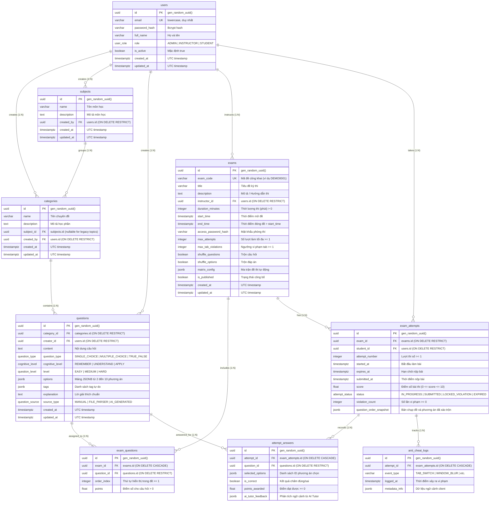

# 📊 SƠ ĐỒ QUAN HỆ THỰC THỂ (ENTITY RELATIONSHIP DIAGRAM - ERD)
## DỰ ÁN: SMART QUIZ — NỀN TẢNG KIỂM TRA & ÔN LUYỆN TRẮC NGHIỆM TRỰC TUYẾN AI
> **Nhiệm vụ:** [Database] Design Relational Schema (ERD) & Database Migrations (#2)  
> **Tài liệu tham chiếu:** `docs/DATABASE_GUIDE.md`, `database/schema.sql`

---

## 1. Sơ đồ Quan hệ Thực thể Tổng thể (Mermaid ERD)

---

## 2. Danh mục 5 Kiểu Enum Native

1. **`user_role`**: `'ADMIN'`, `'INSTRUCTOR'`, `'STUDENT'`
2. **`question_type`**: `'SINGLE_CHOICE'`, `'MULTIPLE_CHOICE'`, `'TRUE_FALSE'`
3. **`cognitive_level`**: `'REMEMBER'`, `'UNDERSTAND'`, `'APPLY'`
4. **`question_level`**: `'EASY'`, `'MEDIUM'`, `'HARD'` (độ khó câu hỏi, độc lập với điểm khi đưa vào đề)
5. **`attempt_status`**: `'IN_PROGRESS'`, `'SUBMITTED'`, `'LOCKED_VIOLATION'`, `'EXPIRED'`
6. **`question_source`**: `'MANUAL'`, `'FILE_PARSER'`, `'AI_GENERATED'`

---

## 3. Ma trận Khóa ngoại & Hành vi Xóa (Foreign Keys & Cascade Rules)

| Bảng nguồn | Cột FK | Bảng đích | Ràng buộc `ON DELETE` | Mục đích nghiệp vụ |
| :--- | :--- | :--- | :---: | :--- |
| `categories` | `created_by` | `users(id)` | **RESTRICT** | Không cho xóa user đang sở hữu chuyên đề. |
| `subjects` | `created_by` | `users(id)` | **RESTRICT** | Không cho xóa user đang sở hữu môn học. |
| `categories` | `subject_id` | `subjects(id)` | **SET NULL** | Giữ lại chuyên đề cũ nếu môn học bị xóa. |
| `questions` | `category_id` | `categories(id)` | **RESTRICT** | Chuyên đề có câu hỏi thì không được xóa thẳng. |
| `questions` | `creator_id` | `users(id)` | **RESTRICT** | Giữ lịch sử tác giả tạo câu hỏi. |
| `exams` | `instructor_id` | `users(id)` | **RESTRICT** | Bảo toàn danh tính giảng viên ra đề. |
| `exam_questions` | `exam_id` | `exams(id)` | **CASCADE** | Xóa đề thi tự động xóa bảng trung gian câu hỏi. |
| `exam_questions` | `question_id` | `questions(id)` | **RESTRICT** | Không thể xóa câu hỏi khi đang nằm trong đề thi. |
| `exam_attempts` | `exam_id` | `exams(id)` | **RESTRICT** | Không được xóa đề thi khi đã có thí sinh làm bài. |
| `exam_attempts` | `student_id` | `users(id)` | **RESTRICT** | Bảo toàn kết quả thi của thí sinh. |
| `attempt_answers` | `attempt_id` | `exam_attempts(id)` | **CASCADE** | Xóa bài thi sẽ dọn sạch câu trả lời chi tiết. |
| `attempt_answers` | `question_id` | `questions(id)` | **RESTRICT** | Bảo toàn liên kết câu hỏi với câu trả lời. |
| `anti_cheat_logs` | `attempt_id` | `exam_attempts(id)` | **CASCADE** | Xóa bài thi sẽ xóa nhật ký vi phạm liên quan. |

---

## 4. Các Ràng buộc Đặc biệt Cần Lưu ý

- **Hoán đổi thứ tự câu hỏi:** `uq_exam_questions_exam_order UNIQUE (exam_id, order_index) DEFERRABLE INITIALLY DEFERRED` cho phép tráo đổi vị trí câu hỏi trong 1 transaction mà không bị lỗi trùng thứ tự tạm thời.
- **Duy nhất 1 bài thi đang làm:** Chỉ mục từng phần `uq_exam_attempts_one_in_progress` đảm bảo thí sinh chỉ có duy nhất 1 bài `IN_PROGRESS` cho cùng 1 đề tại 1 thời điểm.
- **Ràng buộc công bố đề thi:** Nếu `is_published = true`, bắt buộc `start_time` và `end_time` không được NULL.
- **Kiểm tra trạng thái nộp bài:** Nếu `status = 'IN_PROGRESS'` thì `submitted_at` phải NULL. Khi đã nộp bài (`SUBMITTED`, `LOCKED_VIOLATION`, `EXPIRED`), `submitted_at` bắt buộc có giá trị.
